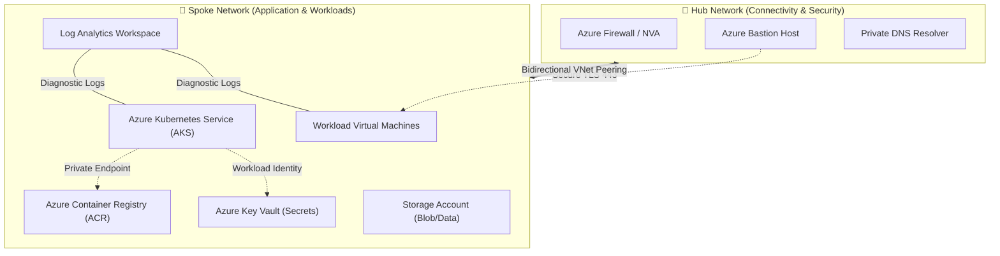

# 🏗️ Enterprise Azure Terraform Modules

[](https://github.com/1-Anand/Terraform-Modules/actions/workflows/terraform-ci.yml)
[](https://www.terraform.io)
[](https://registry.terraform.io/providers/hashicorp/azurerm/latest)
[](https://github.com/aquasecurity/trivy)
[](LICENSE)

A modular, production-ready Infrastructure as Code (IaC) repository for provisioning secure, scalable, and resilient enterprise workloads on Microsoft Azure. Designed following the **Microsoft Cloud Adoption Framework (CAF)** and **Zero-Trust Network Architecture**.

---

## 🏛️ High-Level Enterprise Architecture



---

## 📦 Modular Components Catalog

| Module | Purpose | Key Enterprise Capabilities |
| :--- | :--- | :--- |
| **`modules/aks_cluster`** | Managed Kubernetes Control Plane | Managed Identity, Azure CNI, Node Auto-scaling, Workload Identity |
| **`modules/virtual_network`** | Foundation Virtual Network | Multi-tier Subnets, CIDR partitioning, Network Security integration |
| **`modules/subnet`** | Subnet provisioning & delegation | Service Endpoints, Private Endpoint delegation, NSG association |
| **`modules/azurerm_bastion_host`** | Zero-Public-IP Administrative Access | Native browser-based RDP/SSH without exposing public ports |
| **`modules/key_vault`** | Secrets & Cryptographic Management | RBAC authorization, Purge Protection, Private Endpoint support |
| **`modules/container_registry`** | Enterprise Private Image Repository | Premium SKU, Geo-replication, Content Trust, Vulnerability Scanning |
| **`modules/storage_account`** | Resilient Object & File Storage | TLS 1.3 enforced, Blob versioning, Private Endpoints, Customer-Managed Keys |
| **`modules/network_security_group`**| Stateful Layer 4 Traffic Filtering | Least-privilege inbound/outbound rules, diagnostic logging |
| **`modules/virtual_machine`** | Hardened Linux & Windows Compute | Cloud-init scripting, Managed Disks with SSE, Custom Script Extensions |
| **`modules/log_analytics_workspace`**| Centralized Observability & SIEM | Azure Monitor integration, Microsoft Sentinel ready, retention tiers |
| **`modules/nic` & `modules/pip`** | Network Interface & Public IPs | Static IP reservation, accelerated networking, IP configuration |

---

## 🚀 Quick Start Example: Consuming Modules

```hcl
module "hub_vnet" {
  source              = "./modules/virtual_network"
  resource_group_name = "rg-hub-enterprise-dev"
  location            = "eastus2"
  vnet_name           = "vnet-hub-prod-001"
  address_space       = ["10.100.0.0/16"]
}

module "aks_workload" {
  source              = "./modules/aks_cluster"
  resource_group_name = "rg-spoke-enterprise-dev"
  location            = "eastus2"
  cluster_name        = "aks-enterprise-workload-01"
  dns_prefix          = "aksworkload01"
  subnet_id           = module.hub_vnet.subnet_ids["aks-subnet"]
}
```

---

## 🔒 Security & Compliance Architecture

- **Zero-Trust Network Isolation**: All internal communication routes through private virtual networks and Azure Private Links.
- **Credential-less Authentication**: Uses **Azure Workload Identity Federation** and Managed Identities to eliminate hardcoded service principal secrets.
- **State File Protection**: Terraform state is encrypted at rest with AES-256 and locked via Azure Blob Storage lease management with Entra ID RBAC.
- **Automated IaC Security Gate**: Every pull request is verified with automated syntax, formatting, and Trivy static vulnerability scanning.

---

## 🤝 Collaboration & Quality Standards

- Managed and maintained by **[Anand Bhushan](https://github.com/1-Anand)** (Azure DevOps & Cloud Platform Engineer).
- Continuous peer code review and collaborative trunk-based development with automated GitHub Actions CI.
